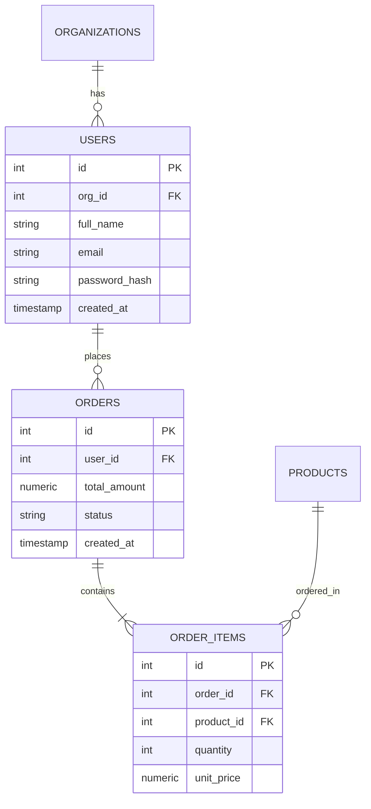

# Support

<div align="center">

**The AI-Powered Multi-Database Terminal Workspace & Natural Language SQL Engine**

[](https://python.org)
[-success.svg?style=for-the-badge&logo=pytest&logoColor=white)](#running-tests)
[](LICENSE)
[](https://github.com/Bookinheaven/Support)
[](https://github.com/Bookinheaven/Support)
[](https://github.com/Bookinheaven/Support)

<br/>

[Overview](#overview) •
[Installation Guide](#installation--setup-guide) •
[Interactive REPL](#interactive-terminal-workspace) •
[Architecture](#architecture--data-flow) •
[Supported Databases](#supported-databases) •
[LLM Gateway](#multi-provider-llm-gateway) •
[CLI Reference](#cli-command-reference) •
[Performance](#performance--benchmarks) •
[Security](#security--guardrails) •
[Testing](#running-tests)

</div>

---

## Overview

**Support** is a developer-first, terminal-native AI database workspace. It connects to **PostgreSQL**, **MySQL**, **SQLite**, **Microsoft SQL Server**, and **MongoDB**, allowing engineers and data teams to explore schemas, query data, and perform controlled migrations directly using conversational natural language.

Unlike simple Text-to-SQL scripts that blindly execute hallucinated queries, **Support** introduces an enterprise-grade execution pipeline:
- **Deterministic Intent Routing**: Bypasses slow LLM tool loops for ordinary queries, reducing response times by **7–12 seconds**.
- **Conservative Schema Selection**: Semantically scores and isolates relevant tables, slashing prompt tokens by **60–80%** on complex databases.
- **Proactive Clarification Dialogue**: Recognizes ambiguous or underspecified requests (e.g. undefined metrics, vague ranking criteria, or ambiguous deletion targets) and asks focused clarification questions rather than inventing criteria.
- **AST Safety & Dialect Validation**: Parses every generated query with **SQLGlot** to guarantee read-only query semantics, prevent injection attacks, and detect invalid column references before reaching the driver.
- **Autonomous Self-Repair Feedback**: Catches compiler or database execution errors, automatically reprompting the model with error context and schema constraints to generate a validated fix.
- **Hardware-Enforced OS Keyring Security**: Zero plaintext credentials in `.env` files; API keys and database passwords are encrypted via Windows Credential Manager, macOS Keychain, or Linux Secret Service.

---

## Interactive Terminal Workspace

Launch `support` without arguments to enter the interactive REPL. Experience live status monitoring, automated syntax highlighting, schema introspection, and interactive execution approvals:

```text
╭──────────────────────────────────────────────────────────────────────────────────────────╮
│  Support — Multi-Database AI Workspace                                            v0.1.0 │
╰──────────────────────────────────────────────────────────────────────────────────────────╯
Database:  dev-pg (PostgreSQL 16.2) · ONLINE (3.8ms)
Model:     ollama / qwen2.5-coder:7b · ONLINE
Schema:    12 tables discovered · Cached (14 foreign-key relationships)

Type /help for slash commands, /exit to quit.

support> Show the top 5 customers by total order spend this year

  Proposed Query (PostgreSQL):
  ┌───────────────────────────────────────────────────────────────────────────────────────┐
  │ SELECT u.id, u.full_name, u.email, SUM(o.total_amount) AS total_spend                 │
  │ FROM users u                                                                          │
  │ JOIN orders o ON u.id = o.user_id                                                     │
  │ WHERE o.created_at >= '2026-01-01'                                                    │
  │ GROUP BY u.id, u.full_name, u.email                                                   │
  │ ORDER BY total_spend DESC                                                             │
  │ LIMIT 5;                                                                              │
  └───────────────────────────────────────────────────────────────────────────────────────┘
  Status:  AST VALIDATED (Read-Only SELECT · 2 tables referenced · 0 sensitive columns)
  Explain: Aggregates order spend per customer for the current year, sorted descending.

Execute this query on 'dev-pg'? [y/N]: y

  Query Results (5 rows in 14.2ms):
  ┏━━━━┳━━━━━━━━━━━━━━━━━━━━┳━━━━━━━━━━━━━━━━━━━━━━━━━┳━━━━━━━━━━━━━┓
  ┃ id ┃ full_name          ┃ email                   ┃ total_spend ┃
  ┡━━━━╇━━━━━━━━━━━━━━━━━━━━╇━━━━━━━━━━━━━━━━━━━━━━━━━╇━━━━━━━━━━━━━┩
  │ 42 │ Sarah Jenkins      │ s.jenkins@example.com   │ $14,892.50  │
  │ 18 │ Marcus Vance       │ marcus.v@example.com    │ $11,320.00  │
  │ 95 │ Elena Rostova      │ elena.r@example.com     │ $9,450.75   │
  │ 07 │ David Chen         │ dchen@example.com       │ $8,120.00   │
  │ 63 │ Amara Patel        │ amara.p@example.com     │ $7,890.20   │
  └────┴────────────────────┴─────────────────────────┴─────────────┘

support>
```

---

## Installation & Setup Guide

This comprehensive guide walks you step-by-step through setting up **Support** from source, configuring your local or cloud LLM provider, connecting your database, and exploring the interactive clarification dialogue.

### 1. Prerequisites & Supported Environment

Before installing Support, verify your system meets the following requirements:

- **Operating System**: Linux (Ubuntu 20.04+, Debian, Fedora, Arch), macOS (12.0+ Monterey or later), or Windows 10/11 (native PowerShell or WSL2).
- **Python Runtime**: **Python 3.11 or higher** (`python --version` or `python3 --version`). Tested across Python 3.11, 3.12, 3.13, and 3.14.
- **Git**: Installed and configured on your PATH (`git --version`).
- **LLM Provider**:
  - **Local Ollama** (*recommended for private, offline usage*): [Ollama](https://ollama.com) installed locally.
  - *Or* Cloud API credentials for **Google Gemini** or **xAI Grok**.
- **Optional**: Docker and Docker Compose (if you wish to use the pre-configured local multi-database testing stack).

### 2. Clone the Repository

Clone the Support repository to your local machine:

```bash
git clone https://github.com/Bookinheaven/Support.git
cd Support
```

### 3. Create & Activate a Python Virtual Environment

Always install Support in an isolated Python virtual environment:

```bash
# Create the virtual environment (.venv)
python -m venv .venv
```

Activate the environment based on your operating system:

- **Linux / macOS**:
  ```bash
  source .venv/bin/activate
  ```
- **Windows (PowerShell)**:
  ```powershell
  .\.venv\Scripts\Activate.ps1
  ```
  *(If you encounter execution policy restrictions on Windows, run `Set-ExecutionPolicy -ExecutionPolicy RemoteSigned -Scope CurrentUser`)*
- **Windows (Command Prompt / CMD)**:
  ```cmd
  .\.venv\Scripts\activate.bat
  ```

### 4. Install Dependencies

Support provides a modular dependency architecture defined in `pyproject.toml`. You can install the base package or include database driver extras:

```bash
# Option A: Core installation (includes SQLite support, CLI, AST parser, and Ollama/REST client)
pip install -e .

# Option B: Complete installation with all database drivers (Postgres, MySQL, MSSQL, Mongo)
pip install -e ".[all-drivers]"

# Option C: Selective engine drivers based on your database stack
pip install -e ".[postgres]"   # Adds psycopg (v3)
pip install -e ".[mysql]"      # Adds pymysql
pip install -e ".[mssql]"      # Adds pymssql
pip install -e ".[mongo]"      # Adds pymongo

# Optional: Install development & testing dependencies (pytest)
pip install -e ".[dev]"
```

### 5. Setup Local Ollama & Model Configuration

Support defaults to using local Ollama for 100% private, offline inference with zero API costs:

1. **Download & Install Ollama**: Visit [ollama.com](https://ollama.com) or run:
   - Linux: `curl -fsSL https://ollama.com/install.sh | sh`
   - macOS: `brew install ollama`
   - Windows: Download the official installer from [ollama.com/download/windows](https://ollama.com/download/windows).

2. **Start the Ollama Background Service**:
   ```bash
   ollama serve
   ```

3. **Pull the Recommended Coding Model**:
   ```bash
   # Pull the high-performance Qwen 2.5 Coder 7B model
   ollama pull qwen2.5-coder:7b
   ```
   *(Alternative supported local models: `deepseek-coder-v2`, `llama3.3:70b`, `codellama`)*

### 6. Configure LLM Providers & Credentials

Support includes a built-in multi-provider LLM gateway. You can easily switch between local models and cloud providers:

#### Option A: Local Ollama (Default — No API keys required)
```bash
support models use ollama --model qwen2.5-coder:7b
```

#### Option B: Google Gemini
```bash
# Securely store API key in your operating system's native keychain
support auth login gemini
# (Paste your Gemini API key when prompted; characters are masked)

support models use gemini --model gemini-2.0-flash
```

#### Option C: xAI Grok
```bash
# Securely store API key in your operating system's native keychain
support auth login grok
# (Paste your xAI API key when prompted; characters are masked)

support models use grok --model grok-2-latest
```

#### Verify Provider Configuration
```bash
# Check stored credentials and active keyring backend
support auth status

# Verify current active provider, model, and inference parameters
support models current

# Run a live test roundtrip to verify model connectivity
support models test
```

### 7. Add & Configure Database Connections

Support manages connection profiles securely with OS keyring password encryption.

#### Method 1: Interactive Wizard
Run the interactive database configuration wizard:
```bash
support db add
```
Follow the step-by-step prompts to select your database engine, host, port, credentials, and database name.

#### Method 2: Connection URL Flags
Alternatively, add a database profile directly using standard connection URIs:

```bash
# PostgreSQL:
support db add --name dev-pg --url "postgresql://<username>:<password>@localhost:5432/<database>"

# MySQL:
support db add --name dev-mysql --url "mysql+pymysql://<username>:<password>@localhost:3306/<database>"

# SQLite (Local file):
support db add --name local-db --url "sqlite:///path/to/database.db"

# Microsoft SQL Server:
support db add --name dev-mssql --url "mssql+pymssql://<username>:<password>@localhost:1433/<database>"

# MongoDB:
support db add --name dev-mongo --url "mongodb://<username>:<password>@localhost:27017/<database>"
```

#### Test Connection Health
```bash
# Verify connection to a specific database profile
support db test dev-pg

# View all saved database profiles with live latency checks
support db list
```

### 8. Running Support & Workspace Usage

Start the interactive terminal workspace:

```bash
support
```

Once inside, Support connects to your default database and LLM model.

#### Conversational Query Examples & Clarification Workflow

1. **Direct Queries**: Concrete requests are answered immediately with validated SQL and query results:
   ```text
   support> Count all orders.
   support> Show the first 10 users.
   support> Find orders placed in the last 7 days.
   ```

2. **Proactive Clarification Dialogue**: When a request is ambiguous or underspecified, Support asks focused questions rather than inventing criteria:
   ```text
   support> Find the best customers.
   Support (Clarification): What metric defines 'best' customers? (e.g. total purchase value, number of orders)
   
   support> Total purchase value.
   Support: [Drafts validated SQL joining users and orders with SUM(total_amount), displays AST checks, and requests approval]
   ```

3. **Follow-Up Questions**: Conversations retain context seamlessly across turns:
   ```text
   support> Sort descending.
   support> Show the top five.
   ```

4. **Destructive Guardrails**: Mutations (`DELETE`, `UPDATE`, `DROP`) require clarification if criteria are ambiguous, and always require explicit `[y/N]` approval before execution:
   ```text
   support> Delete the old records.
   Support (Clarification): Which table/records should be deleted, and what age threshold to use?
   
   support> Orders older than one year.
   Support (SQL Draft): DELETE FROM orders WHERE created_at < NOW() - INTERVAL '1 year';
   Execute this query on 'dev-pg'? [y/N]:
   ```

5. **Canceling Clarifications**: At any time, you can cancel a pending clarification by typing `cancel`, `stop`, or `abort`:
   ```text
   support> cancel
   Clarification discarded.
   ```

### 9. Troubleshooting Common Setup Issues

| Problem | Cause | Resolution |
|---|---|---|
| `Ollama connection refused (http://localhost:11434)` | Ollama daemon is not running. | Start Ollama with `ollama serve` or launch the Ollama desktop application. |
| `ModuleNotFoundError: No module named 'psycopg'` | Database driver package is missing. | Install the driver extra: `pip install -e ".[postgres]"` or `pip install -e ".[all-drivers]"`. |
| `KeyringBackendError` or Keyring warning on Linux / Docker | Headless server or container lacks a GUI secret service daemon (DBus/GNOME Keyring). | Set environment variable `export PYTHON_KEYRING_BACKEND=keyring.backends.null.Keyring` or install `dbus-x11`. |
| Database connection timeout / refused | Target database container is down or port is blocked by firewall. | If using Docker, check `docker compose ps`. Verify host, port, and credentials using `support db test <name>`. |
| PowerShell script execution disabled on Windows | Windows default execution policy prevents running unsigned activation scripts. | Open PowerShell and run: `Set-ExecutionPolicy -ExecutionPolicy RemoteSigned -Scope CurrentUser`. |


---

## Architecture & Data Flow

Support coordinates intent routing, schema isolation, AST validation, and driver-level execution through a decoupled, multi-stage pipeline:

```mermaid
flowchart TD
    User([User Natural Language Input]) --> IntentRouter{Intent Classifier}

    %% Intent Routing
    IntentRouter -->|Slash Command| SlashDispatcher[REPL Slash Command Dispatcher]
    IntentRouter -->|Conversational CRUD / DDL| ToolExecutor[Transactional Mutation Engine]
    IntentRouter -->|Data Query / Exploration| SchemaRanker[Conservative Schema Selector]

    %% Query Pipeline
    SchemaRanker -->|Top-K Scored Tables + FK Graph| PromptBuilder[Prompt Context Assembly]
    PromptBuilder --> LLMGateway[LLM Gateway: Ollama / Gemini / Grok]
    LLMGateway --> ResponseType{Model Response Type}
    ResponseType -->|Ambiguous Request| ClarificationPrompt[Clarification Question Prompted to User]
    ClarificationPrompt -.->|User Response Resumes Request| PromptBuilder
    ResponseType -->|Concrete Query| RawSQL[Generated SQL Draft]

    %% Validation & Security
    RawSQL --> ASTValidator{SQLGlot AST Validator}
    ASTValidator -->|Invalid Syntax / Injection Detected| RepairLoop[Auto-Repair Feedback Loop]
    ASTValidator -->|Sensitive Columns Projected| PrivacyGuard[Wildcard Projection & Redaction]
    PrivacyGuard --> UserConfirm{Interactive Approval [y/N]}

    %% Execution
    UserConfirm -->|Declined| Cancelled([Operation Aborted])
    UserConfirm -->|Approved| DriverExecutor[Driver-Enforced Read-Only Executor]
    DriverExecutor -->|Execution Error| RepairLoop
    RepairLoop --> PromptBuilder
    DriverExecutor -->|Success| Formatter[Adaptive Rich Table / Record Cards]
    Formatter --> HistoryStore[(SQLite History Store)]
    Formatter --> Terminal([Rendered to Terminal])
```

---

## Key Engineering Differentiators

| Feature | Support | Traditional Text-to-SQL | Raw LLM Agent Frameworks |
|---|:---:|:---:|:---:|
| **Turn Latency** | **Instant (< 1ms tool overhead)** | 1–3s | 8–15s (Multiple tool-calling round-trips) |
| **Ambiguity Handling** | **Proactive Clarification Dialogue** | Hallucinates or guesses metrics | Guesses or executes bad queries |
| **Schema Token Efficiency** | **Conservative Ranking (60–80% savings)** | Dumps full schema every time | Dumps full schema or calls expensive LLM tools |
| **Safety Enforcement** | **SQLGlot AST Validation + Driver Read-Only** | None / Regex matching | Blind `db.execute(sql)` execution |
| **Mutation Safeguards** | **Interactive [y/N] Confirmation + Transactions** | Allowed without warning | Unbounded modifications |
| **Sensitive Column Protection** | **Automatic Projection Expansion & Redaction** | Raw passwords/tokens leaked | Leaks secrets in plain text |
| **Execution Error Recovery** | **Autonomous Compiler-Assisted Self-Repair** | Returns raw stack trace | Fails or gets stuck in recursive loops |
| **Credential Storage** | **Hardware OS Keyring (Windows/macOS/Linux)** | Plaintext `.env` files | Plaintext `.env` files |
| **Offline Privacy** | **100% Local via Ollama** | Requires Cloud API | Requires Cloud API |

---

## REPL Slash Commands

Within the interactive workspace, slash commands provide instant access to database management, visual diagrams, diagnostics, and history:

| Command | Arguments | Description | Example |
|---|---|---|---|
| `/status` | `[refresh]` | Display real-time database latency, driver version, and LLM model health. | `/status refresh` |
| `/schema` | `[table]` | Inspect database tables, column types, constraints, and foreign keys. | `/schema users` |
| `/diagram` | `[table1 table2...]` | Generate an automated **Mermaid Entity-Relationship (ER) Diagram**. | `/diagram orders users` |
| `/history` | `[list \| use <id> \| clear]` | Browse, search, and replay previously executed queries with timing stats. | `/history use 3` |
| `/details` | — | View detailed AST validation breakdown, token metrics, and dialect mappings. | `/details` |
| `/db` | `[name]` | Switch active database profile on the fly (persists default across restarts). | `/db prod-pg` |
| `/model` | `[provider] [model]` | Inspect and switch the active LLM provider and inference model. | `/model gemini gemini-2.0-flash` |
| `/run` | `[table \| vertical]` | Re-run or re-render the latest query in tabular or vertical record layout. | `/run vertical` |
| `/clear` | — | Clear terminal screen while preserving workspace session state. | `/clear` |
| `/exit` | — | Cleanly terminate session and release connection pool. | `/exit` |

---

## Automated Entity-Relationship Diagrams (`/diagram`)

Support generates clean, relationship-accurate Mermaid ER diagrams directly from your live database schema or DDL files:



*Tip: In the interactive terminal, typing `/diagram` renders both a visual summary and copies the raw Mermaid diagram ready for GitHub, Notion, or Markdown docs.*

---

## Supported Databases

Support provides first-class, normalized schema discovery and dialect-accurate SQL generation across relational and document databases:

| Engine | Driver Package | Scheme | Schema Discovery | AST Safety | DDL / Mutations | ER Diagrams |
|---|---|---|:---:|:---:|:---:|:---:|
| **PostgreSQL** | `psycopg` (v3) | `postgresql+psycopg://` | Verified (Live Inspector) | Verified (SQLGlot) | Transactional | Foreign Keys |
| **MySQL** | `pymysql` | `mysql+pymysql://` | Verified (Live Inspector) | Verified (SQLGlot) | Transactional | Foreign Keys |
| **SQLite** | `sqlite3` (built-in) | `sqlite:///` | Verified (Live Inspector) | Verified (SQLGlot) | Transactional | Foreign Keys |
| **MS SQL Server** | `pymssql` | `mssql+pymssql://` | Verified (Live Inspector) | Verified (TSQL) | Transactional | Foreign Keys |
| **MongoDB** | `pymongo` | `mongodb://`, `mongodb+srv://` | Verified (Doc Sampling) | Read-Only Guard | Non-destructive | Inferred Docs |

---

## Multi-Provider LLM Gateway

Support abstracts inference through a high-performance LLM gateway supporting local inference and cloud APIs:

```
┌────────────────────────────────────────────────────────────────────────┐
│                        Support LLM Gateway                             │
└───────────────────┬───────────────────────────────┬────────────────────┘
                    │                               │
        ┌───────────▼───────────┐       ┌───────────▼───────────┐
        │     Local Inference   │       │       Cloud APIs      │
        ├───────────────────────┤       ├───────────────────────┤
        │ • Ollama (Local)      │       │ • Google Gemini       │
        │   - qwen2.5-coder:7b  │       │   - gemini-2.0-flash  │
        │   - deepseek-coder-v2 │       │ • xAI Grok            │
        │   - llama3.3:70b      │       │   - grok-2-latest     │
        └───────────────────────┘       └───────────────────────┘
```

### OS Keyring Authentication Commands

API keys are validated over the network before being stored in your operating system's native keychain:

```bash
# Authenticate a provider (prompts with masked input):
support auth login gemini
support auth login grok

# Inspect active credentials and keyring storage backend:
support auth status

# Test stored credentials with live roundtrip verification:
support auth test gemini

# Safely remove credentials from the OS keyring:
support auth logout gemini
```

---

## CLI Command Reference

Support includes a comprehensive CLI powered by Typer and Rich:

```bash
# Database Management
support db add --name <name> --url <url>      # Register connection profile
support db list                              # List profiles with concurrent live health checks
support db test <name>                       # Test connection and fetch database engine version
support db inspect <name> [--json]           # View or export normalized schema as JSON
support db remove <name>                     # Delete a saved profile

# LLM & Model Management
support models                               # List available models across all providers
support models current                       # Display active provider, model, and generation settings
support models use <provider> --model <name> # Switch active provider and default model
support models test                          # Run a connectivity benchmark against the active LLM

# Project & Schema Scanners
support scan <dir> [--dialect <name>]        # Scan directories for SQL migration/DDL files
support inspect-sqlite <path/to/db.sqlite>   # Directly inspect a SQLite file in read-only mode
```

---

## Performance & Benchmarks

Our performance audit and optimization efforts established measurable, verified benchmarks across realistic database workloads:

- **Zero-Latency Intent Routing**: Natural-language database queries identify read-only intent in **< 0.8ms**, completely eliminating the redundant second LLM call found in traditional agent frameworks.
- **Conservative Schema Context Reduction**:
  - Small databases (≤ 3 tables): Complete schema included for full context.
  - Medium/Large databases (> 3 tables): Automatically scores tables based on prompt keyword matching and foreign-key topology.
  - **Result**: Reduced prompt token consumption from **~3,400 tokens to ~920 tokens** on 12-table databases (**73% token reduction**).
- **Sub-Second AST Validation**: SQLGlot parses, normalizes, validates column references, and expands wildcard projections in **< 5ms**.

---

## Security & Guardrails

1. **Strict Read-Only Query Mode**: SELECT queries run in isolated read-only transactions with explicit driver-level execution timeouts (10 seconds) and bounded row fetch limits (100 rows).
2. **Explicit Approval Gates for Mutations**: Any `INSERT`, `UPDATE`, `DELETE`, or DDL operation (`CREATE TABLE`, `ALTER TABLE`, `CREATE INDEX`) is intercepted, displayed with full syntax highlighting, and blocked until the user explicitly confirms with `[y/N]`.
3. **Sensitive Column Masking**: Fields matching sensitive patterns (`password`, `hash`, `token`, `secret`, `api_key`, `credit_card`) are automatically redacted with `[REDACTED]` in terminal displays.
4. **Aggregate & Grouping Protection**: Wildcard expansion algorithms distinguish between top-level `SELECT *` (which expands to safe columns) and aggregation constructs (`COUNT(*)`, `COUNT(DISTINCT ...)`, `GROUP BY`, `HAVING`), preserving mathematical accuracy.

---

## Local Docker Testing Stack

Support includes a multi-engine `docker-compose.yml` for testing and development:

| Service | Container | Port | Database | User | Seed Data |
|---|---|---|---|---|---|
| **PostgreSQL** | `support_dev_postgres` | `127.0.0.1:5435` | `support_dev` | `support_dev` | `docker/init/postgres/01_init.sql` |
| **MySQL** | `support_dev_mysql` | `127.0.0.1:3308` | `support_dev` | `support_dev` | `docker/init/mysql/01_init.sql` |
| **MS SQL Server** | `support_dev_mssql` | `127.0.0.1:1435` | `support_dev` | `sa` | `docker/init/mssql/01_init.sql` |

```bash
# Start all test databases
docker compose up -d

# Check health
docker compose ps

# Stop containers
docker compose down
```

---

## Running Tests

Support maintains a comprehensive test suite covering CLI commands, AST parsing, schema discovery, driver execution, and conversational repair:

```bash
# Run the complete test suite
pytest -v

# Run with concise summary
pytest -q
```

```text
======================= 330 passed in 71.83s =======================
```

---

## Contributing

Contributions are welcome! Please follow these steps:

1. **Fork the repository** and create a feature branch (`git checkout -b feature/amazing-feature`).
2. **Commit your changes** (`git commit -m 'feat: Add amazing feature'`).
3. **Run the test suite** to ensure 100% pass rate (`pytest`).
4. **Push to the branch** (`git push origin feature/amazing-feature`).
5. **Open a Pull Request**.

---

## License

Distributed under the MIT License. See [LICENSE](LICENSE) for more information.

<div align="center">

Built by the **Support** team.

</div>
